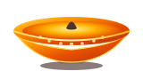

# ✦ Antigravity • Shubh Deepavali ✦

> A futuristic, luminous, and agentic Diwali celebration inspired by the **Google Antigravity** design system. Featuring weightless floating diyas, quantum particle starbursts, strict heading scroll-snapping, and ambient Web Audio sound.

---

## 🌟 Highlights

- **✦ Google Antigravity Aesthetic**:
  - Cosmic deep space obsidian theme with luminous atmospheric quantum nebulae.
  - Frosted glassmorphism UI with hairline gradient highlights and responsive hover glow spotlights.
  - Zero-gravity floating 3D brass diya with orbital light rings.
- **🛑 Strict Heading-by-Heading Snapping**:
  - Halts aggressive inertial flings so scrolling smoothly locks at every single section heading.
- **📱 Auto Mobile Screen Frame**:
  - Built-in smartphone frame simulator on desktop and seamless 100dvh auto-responsive scaling on mobile devices.
- **✨ Quantum Particle Starbursts**:
  - Interactive fireworks canvas with particle physics, zero-G golden stardust, and sparkler cursor trail.
- **🪕 Pure Web Audio API Ambient Sound**:
  - Meditative Indian classical Tanpura drone and crystal harmonic bell chimes.
- **🔒 Protected & Obfuscated Codebase**:
  - Built with minified and obfuscated client assets.

---

## 🚀 Live Site

Experience it live at:
👉 **[https://7rocker7.github.io/diwali/](https://7rocker7.github.io/diwali/)**

---

## 🪔 Shubh Deepavali!
*May the divine light illuminate your path with infinite wisdom, health, and prosperity.* ✨
